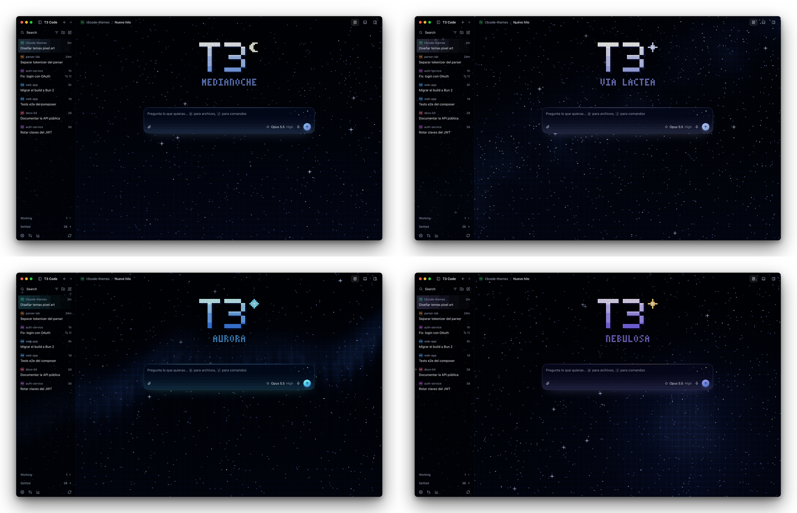
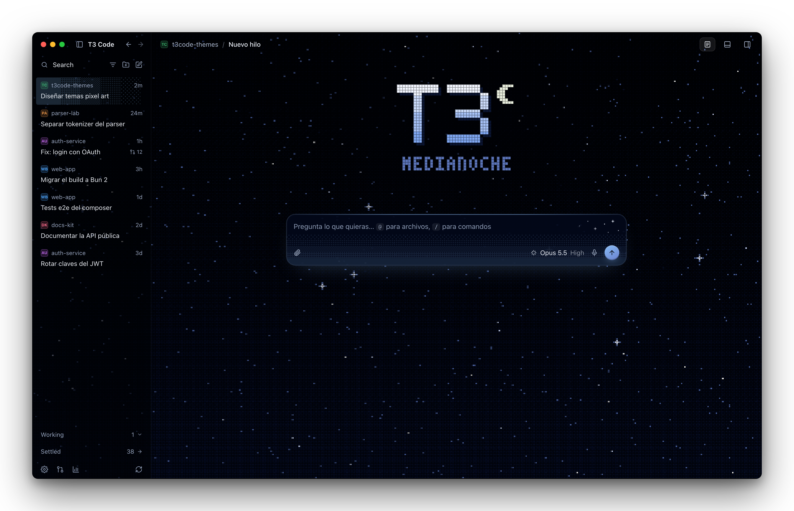
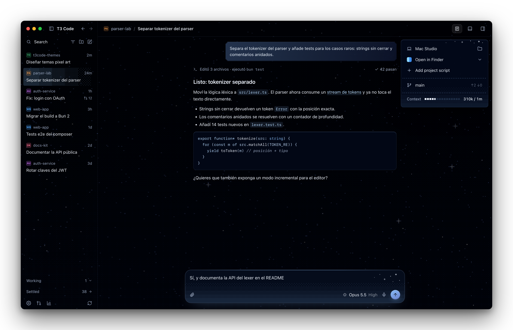
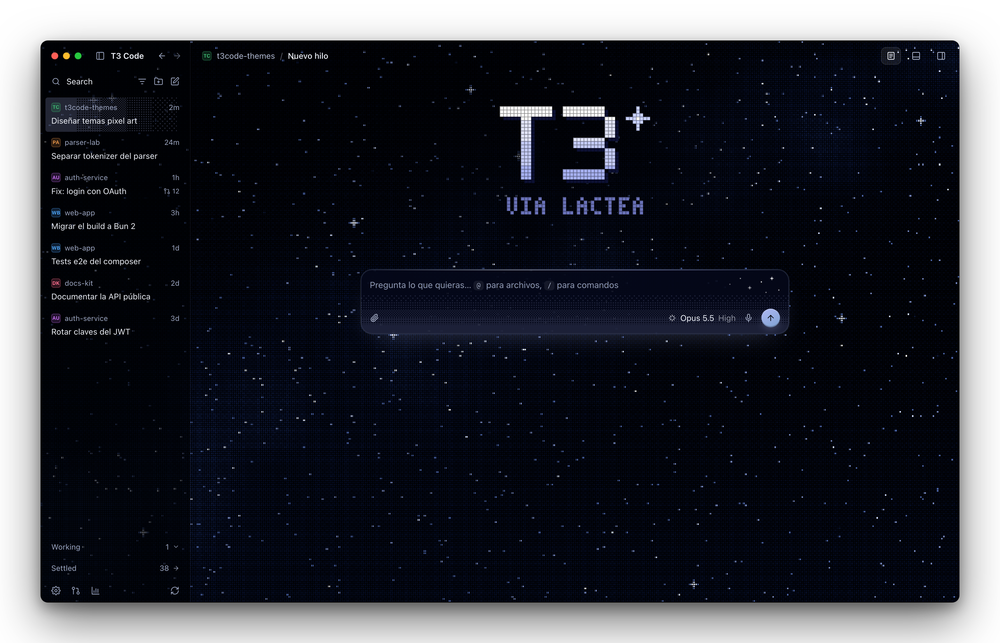
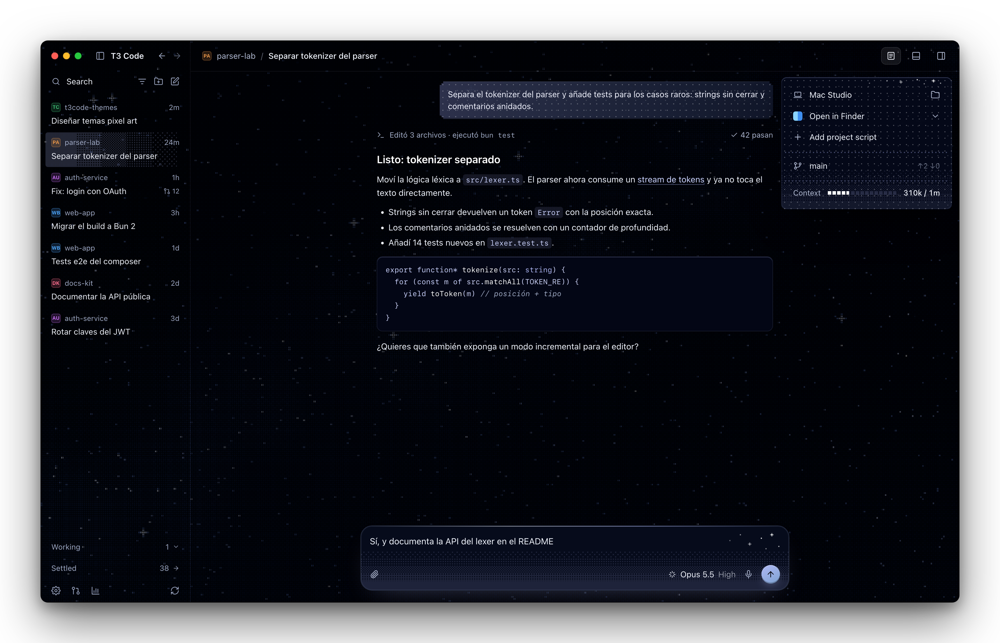
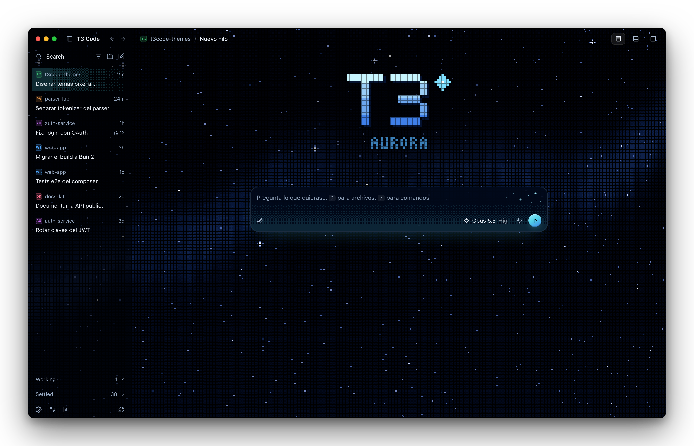
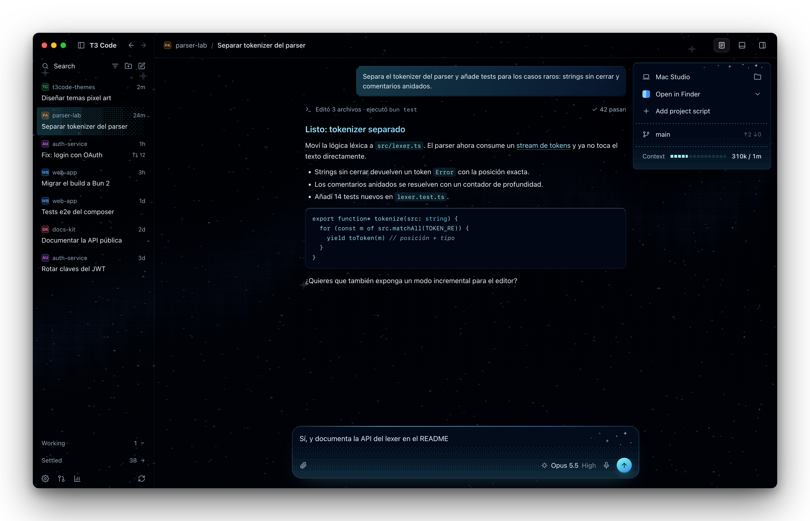
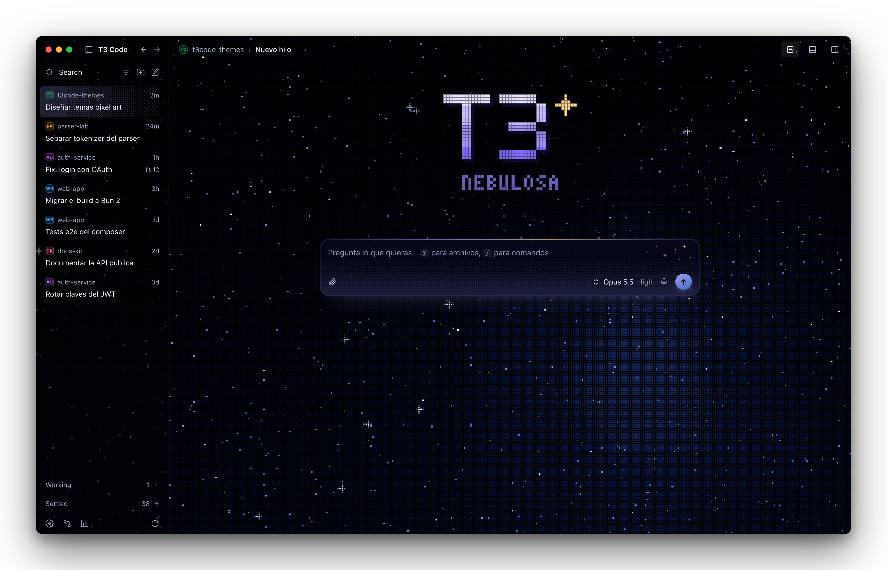
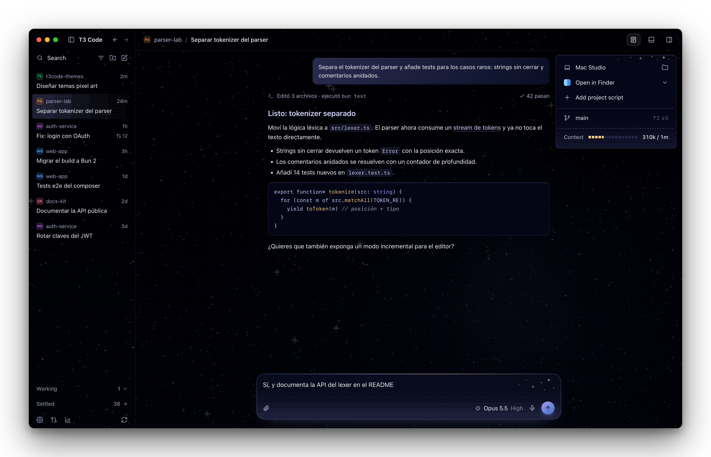

# T3 Code · Temas pixel art nocturnos

Cuatro temas oscuros para T3 Code, cada uno con su propio cielo estrellado en pixel art y detalles a juego en toda la interfaz.

*Four dark pixel-art night-sky themes for T3 Code.*



| Tema | Cielo | Acento | Detalle propio |
|---|---|---|---|
| **Medianoche** | cielo plano | azul hielo | Luna creciente en la carátula; el más minimalista |
| **Vía Láctea** | banda galáctica tenue | plata y lavanda | Polvo de estrellas en la burbuja y la tarjeta de detalles |
| **Aurora Azul** | aurora boreal | cian → azul | Degradados como las cortinas de la aurora |
| **Nebulosa** | nebulosa en la esquina | índigo + dorado | Una sola "estrella" dorada: cursor, estrellas e interruptores |

## Instalación

1. Descarga el `.json` del tema desde [`themes/`](themes).
2. En T3 Code abre **Ajustes → Apariencia** e importa el archivo.

También puedes copiar los `.json` en `~/.t3/userdata/themes/` y elegirlos en Apariencia.
Para volver al tema original, elige **T3 Chat**.

## Qué cambia

- **Fondo**: el cielo cubre toda la ventana, con una rejilla tipo LED sobre cada píxel. Cuando hay mensajes, un velo oscuro lo atenúa para leer cómodo.
- **Pantalla vacía**: una carátula en pixel art con "T3", un icono propio de cada tema y su nombre.
- **Sidebar**: el hilo activo se marca con un tramado (*dither*) que se desvanece en escalones de cuadritos, igual que el cielo.
- **Composer**: un "horizonte estrellado", con un tramado que sube desde abajo y estrellas pixel en la esquina. Se ilumina un poco al escribir.
- **Tarjeta de detalles**: un trozo de cielo con separadores punteados y la barra de contexto por bloques, que pasa a ámbar y luego a rojo cuando el contexto se llena.
- **Mensajes**: tu burbuja tiene esquinas escalonadas tipo píxel. Enlaces, código en línea, citas y bloques de código van a juego con el tema.
- **Accesibilidad**: los textos cumplen el contraste WCAG AA y se respetan *reducir transparencia* y *aumentar contraste* del sistema.

## Rendimiento

Todo es estático: el fondo se pinta una sola vez, sin animaciones. Los temas además **desactivan los desenfoques (`backdrop-filter`) de la app**, que son lo que más GPU consume, así que deberían ir igual o más fluidos que el tema por defecto.

## Capturas

### Medianoche



### Vía Láctea



### Aurora Azul



### Nebulosa



> Las capturas son una réplica de la interfaz de T3 Code con el CSS real de cada tema y contenido de ejemplo.

## Construir desde el código

Los temas se generan con Python 3 y Pillow:

```bash
pip install pillow numpy
python src/sky/gen4.py   # regenera los cielos en backgrounds/
python src/build.py      # regenera themes/*.json
```

- `src/template.css`: el CSS común, con comentarios por secciones.
- `src/x-*.css`: la firma propia de cada tema.
- `src/build.py`: la paleta de cada tema (colores en OKLCH), la carátula y el ensamblado del JSON.
- `src/build/`: CSS legible y carátulas de cada tema, para revisar (no se versiona).

Algunas reglas usan clases internas de T3 Code (la barra de contexto y los botones del composer). Están agrupadas en la sección **Hooks frágiles** de `template.css`. Si una actualización de T3 las cambia, esas partes vuelven a su aspecto normal sin romper el resto.
